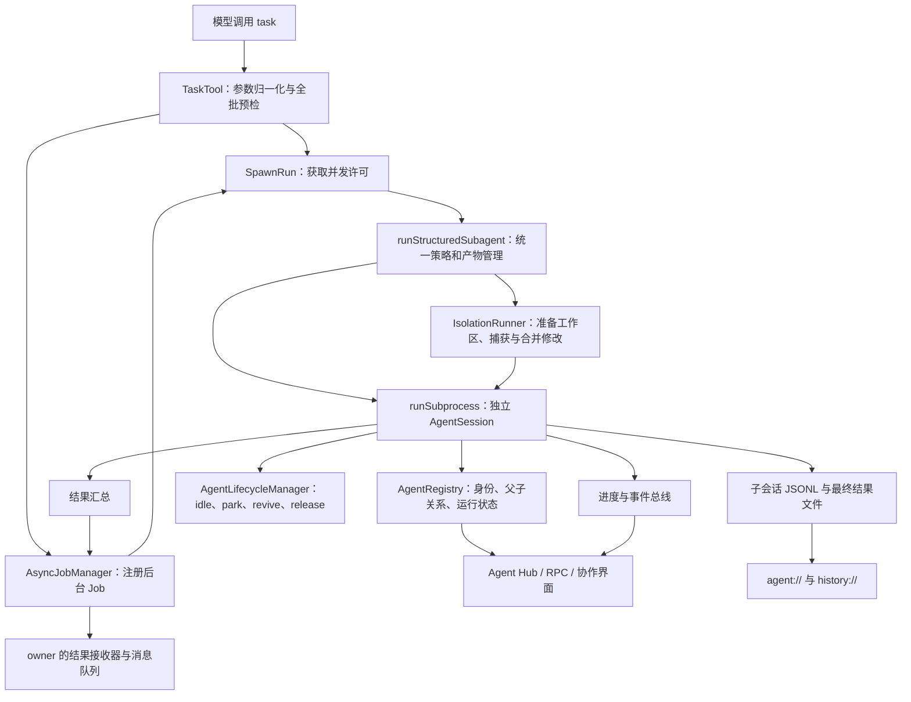

# Subagent 实现调研与 pp 设计依据

调研日期：2026-10-29。本文记录调研时的参考实现与设计依据；核心能力现已落地，当前配置和行为以[子 Agent 使用说明](subagents.md)为准。

参考项目：[can1357/oh-my-pi](https://github.com/can1357/oh-my-pi)。固定源码版本为 [`9f81590ae59e1004583f6305eefb490b2c3f6027`](https://github.com/can1357/oh-my-pi/commit/9f81590ae59e1004583f6305eefb490b2c3f6027)，即本次查询时的 `main`，避免后续分支更新改变本文结论。pp 基线为 `70f2433a2321a46581800fef14f7e281b0a127d8`。

核查方式：本地检出固定版本，通过知识图谱定位符号、追踪调用，并阅读关键源码、配套文档和回归测试。没有运行 OMP，也没有执行其测试；下文的行为结论来自静态核查。文中“OMP 实现”描述已核实的参考行为；“pp 建议”是设计选择，两者明确区分。

## 1. 主要结论

OMP 的 subagent 是“可持续交互的独立 Agent 会话”，包含任务派发、运行调度、后台结果投递、身份注册、消息通信、生命周期、持久化、工作区隔离和人机控制。

对 pp 最有价值的设计边界：

1. **Agent、Run、Job 分开建模。** Agent 保存身份和上下文；Run 表示一次委托或追问；Job 负责异步执行和结果投递。一次 Run 成功或失败后，Agent 都可能继续存在。
2. **复用执行循环，独立会话和工具状态。** OMP 的 `runSubprocess()` 实际调用 `createAgentSession()`，普通与隔离子 agent 都在同一进程运行。工作区隔离不等于进程隔离。
3. **默认显式传递任务上下文。** 普通 child 不复制父对话；任务、批次共享背景、角色、计划引用等构成 child 输入。历史会话咨询另有 `seance`。
4. **结果投递是调度协议。** 后台完成后，结果必须路由到正确的 owner，在合法消息边界进入模型上下文，并与显式等待去重。
5. **取消与释放是两类操作。** 停止一次 Run 可以保留 Agent 供追问；kill 需要释放运行资源并留下持久标记，后续显式恢复才建立新实例。
6. **文件修改的正确性贯穿系统。** 同目录并发写入、子任务退出后的后台命令、隔离补丁合并和 `/changes` 撤销，都必须有明确归属。

建议完整参考这些语义边界，按依赖分阶段落地。第一版即应具备完整的“派发—执行—返回—取消—恢复”闭环；高级隔离后端、推测启动和模型成本优化可以随后实现。

## 2. OMP 的模块与调用链



主路径是 `TaskTool.#dispatch()` → `SpawnRun` → `TaskTool.#runSpawn()` → `runStructuredSubagent()` → `runSubprocess()` → `driveSessionToResult()`。隔离运行在同一条执行路径外包工作区生命周期。`eval agent()`、workpool 等也调用共享的 `runStructuredSubagent()`，避免各入口自行实现策略检查。

核心源码：[任务入口][omp-task]、[统一派发服务][omp-structured]、[执行器][omp-executor]、[单次运行所有权][omp-spawn-run]。

| 模块 | 职责与应保留的边界 |
| --- | --- |
| `task/types.ts` | AgentDefinition、动态调用 schema、输出上限 |
| `task/agents.ts`、`discovery.ts` | 内置定义、Markdown/frontmatter 解析、来源优先级 |
| `task/index.ts` | task 工具、批次校验、同步/异步分流、进度聚合 |
| `task/structured-subagent.ts` | 深度、权限、模型、结构化输出、Plan、隔离等统一预检 |
| `task/spawn-run.ts`、`parallel.ts` | 一次执行的取消、并发许可、资源接管与释放 |
| `task/executor.ts` | child session 构造、执行、进度采集、结果与退出处理 |
| `async/job-manager.ts` | Job 状态、owner 路由、等待、结果消费与重试 |
| `registry/agent-registry.ts` | 全局 Agent 目录、父子关系、实例身份与可见范围 |
| `registry/agent-lifecycle.ts` | 空闲定时驻留、并发恢复、kill tombstone、释放 |
| `irc/` | 消息投递、唤醒和等待，不负责执行工作本身 |
| `task/output-manager.ts`、`internal-urls/` | 唯一输出名、结果与历史读取、消息和 Job 操作入口 |
| `task/worktree.ts`、`isolation-runner.ts` | 工作区准备、基线、补丁/分支、恢复与清理 |
| `task/speculative-launch.ts` | 工具参数尚在流式生成时提前启动完整 task item |
| `task/workpool.ts` | 多项工作分配给可复用 worker，并聚合成一个 Job |

## 3. Agent 定义、发现和模型路由

### 3.1 定义与发现

`AgentDefinition` 必需字段为 `name`、`description`、`systemPrompt`；还支持 `tools`、`spawns`、优先级模型列表、thinking、`output` schema、`blocking`、`structured`、`autoloadSkills`、`readSummarize`、`prewalk`、`advisor`，以及来源和文件路径。

发现顺序为：最近的项目 `.omp/agents` → 用户 `~/.omp/agent/agents` → 生效的 OMP 扩展包 `agents/` → 已启用的 Claude marketplace 插件 agent → 内置定义。同名定义按顺序保留第一个，名称精确匹配且区分大小写；同目录文件按名称排序。直接跨 harness 的 `.claude/agents`、`.codex/agents` 等目录不自动混用。

内置类型实际有 `scout`、`reviewer`、`security-reviewer`、`seance`、`task`、`sonic`。`task` 允许继续派发；`scout` 偏只读搜索，`sonic` 偏机械修改。注意 `reviewer` 工具包含 `bash`，不能仅凭角色名称把它认定为有运行时只读保证。

自定义定义错误通常记录警告并跳过；内置定义错误采用更严格的失败路径。`tools` 未声明与显式空列表语义不同：未声明使用默认工具，空列表表示没有内置工具；结构化模式仍补入必要的 `yield`，MCP/扩展工具还需要单独考虑。

工具描述的发现结果有缓存，但每次真正派发重新加载配置并发现定义。并发批次只合并正在进行的发现请求，扫描结束就清除，兼顾速度与热更新。

来源：[发现实现][omp-discovery]、[定义与内置 agent][omp-agents]、[发现说明][omp-discovery-doc]。

### 3.2 策略与模型优先级

统一预检检查当前深度、父 Agent 的 `spawns` 白名单、被禁止的自递归类型、未知/禁用 Agent、Plan 限制、输出 schema 和隔离开关。**全批次通过策略预检后，常规派发才注册 Job。** 推测启动是后述的例外，需要单独约束。

普通 task 的模型优先级：`task.agentModelOverrides[agentName]` → agent frontmatter 的模型列表 → 父会话当前模型及配置兜底。`@task`、`@smol` 等角色别名展开后选模型。`before_subagent_spawn` 扩展钩子还能阻止派发或改写模型路由。普通 task wire 不提供任意模型覆盖；`seance` 和 eval 内部调用有自己的覆盖路径。

模型、thinking、服务等级、账户池、压缩阈值、请求预算是不同策略。OMP 支持按精确 agent 名分别覆盖；部分值在启动时冻结，其他配置通过 child overlay 读取父配置的实时值。不能笼统认为所有设置都是一次性快照。

pp 建议：建立 `AgentCatalog` 和 `SpawnPolicyResolver`。定义先支持项目 `.pp/agents/*.md`、用户 `~/.pp/agent/agents/*.md`、内置模板三层；插件来源接口保留。Agent 定义与 Skill 保持独立：前者定义角色和能力，后者提供按需读取的知识。模型引用沿用 pp 的 `provider/model` 校验；角色路由和每 Agent 覆盖独立设计，不直接移植 OMP 的全部模型配置。

## 4. 模型可见协议与派发方式

### 4.1 task 输入

OMP 默认开启 batch，模型看到的主要形状如下，示例仅说明参考协议：

```json
{
  "context": "Investigate the current repository before changing code.",
  "tasks": [
    {
      "name": "ExploreRuntime",
      "agent": "scout",
      "task": "Locate the execution loop and explain cancellation boundaries.",
      "solutionSpace": "Architecture discovery; the relevant modules are unknown."
    },
    {
      "name": "ReviewPersistence",
      "agent": "reviewer",
      "task": "Inspect session persistence for concurrency risks.",
      "solutionSpace": "Review failure modes; no known defect."
    }
  ]
}
```

`context` 是批次共享背景，角色和任务选择在每个 item 上；不能把 `agent` 错放顶层。提供的实例名称在批次内不允许大小写不敏感的重复。关闭 batch 后使用单任务形状；开启时运行时仍兼容旧的 flat 调用。

动态 schema 只暴露当前可用的字段：

| 字段/能力 | 暴露条件与实际语义 |
| --- | --- |
| `effort` | `task.enableEffort` 开启；`lo/med/hi` 映射到目标模型支持的档位 |
| `isolated` | 开启隔离且非 Plan；只是布尔开关，合并策略来自设置 |
| `outputSchema`、`schemaMode` | 开启 `task.structured`；单个 Agent 仍可自行声明结构化模式 |
| `taskFile` | 开启 `task.file`；与内联 task 二选一，派发时读取，限制 4 MiB |
| `tools` | eval 工具共享开启；引用父 Python/JS kernel 中已定义的工具，Plan 禁用 |
| `sourceSession`、`model` | `seance` 可用时才暴露，对普通任务不构成任意覆盖能力 |
| `solutionSpace` | schema 声明必需，但运行时允许缺失，自动 thinking 分类退回任务文本 |

pp 建议：先采用 batch task，保持“共享背景 + 自包含任务”。schema 生成、调用验证和运行时执行必须使用同一份策略；隐藏字段仍需运行时拒绝非法使用。是否引入 `solutionSpace` 取决于 pp 是否实现自动 thinking 分类，不能仅复制一个没有消费者的参数。

### 4.2 同步、异步和并发

OMP 默认 `async.enabled=true`。普通任务各注册一个后台 Job，迅速返回 Agent/Job 标识，完成后自动投递；`blocking: true` 的 agent 留在当前调用内执行。同一批次可混合两类：先注册异步项，再等待同步项，最终工具块继续显示后台项进度。没有 JobManager 或关闭 async 时整批回退同步。

`SpawnRun` 自己持有取消控制器、启动/完成 Promise、进度缓存和产物清理函数。无论同步、后台还是推测启动，都经它获取和释放同一个 TaskTool 的 semaphore。当前 OMP 限流范围是每个会话的 TaskTool，不应误称为整个递归树统一的 32 个名额。

许可队列支持取消；取消等待者要从队列移除，否则后续释放可能把名额交给已放弃的任务。运行中修改并发上限采用原地 resize，不能替换 semaphore 而丢失已占用数量。

来源：[TaskTool 派发][omp-task]、[SpawnRun][omp-spawn-run]、[并发实现][omp-parallel]、[任务协议文档][omp-task-doc]。

## 5. Child 上下文、工具与执行循环

### 5.1 输入边界

普通 child 创建独立 `AgentSession` 和 JSONL，不继承父对话历史。系统提示词组合角色、显式 context、批准计划引用、工作区、协作身份和完成协议；任务进入首条 user prompt。父任务已有批准计划时传入计划正文，避免 child 再读一份可能变化的内容。

可复用父 workspace tree、skills、rules、模板及其他 context files；`local://` 根和 ArtifactManager 共享。**OMP 明确排除名为 `AGENTS.md` 的上下文文件**，额外工作区重新发现时也排除。非隔离任务还继承额外工作区，隔离任务清空这些根。`seance` 使用完全不同的历史 fork 策略。

pp 建议默认新上下文，提供“角色 + shared context + task + 必要项目规则 + 计划引用”。pp 当前 `AGENTS.md` 承担项目约束，建议继续加载适用规则；这是相对于 OMP 的明确差异，需要在最终设计中确认并测试，不能在迁移时悄悄丢掉仓库约束。暂不提供任意整段父历史复制；历史咨询应作为独立模式。

### 5.2 工具边界

OMP 由 agent 的工具列表构造 child 工具集，达到递归深度上限后移除 `task` 并清空 spawns。允许派发的显式列表会补 `task`；具备 `task`/`bash` 的列表按条件补 `wait`；legacy `exec` 展开为 `bash` 和可用的 eval。默认去掉父任务拥有的 `todo`，prewalk 等特殊流程另行处理。

child 没有 UI，OMP 把确认模式覆盖为 `yolo`，但用户配置的工具 approval 规则仍适用；不能概括成“忽略所有权限”。Plan child 限制为调查工具、禁止继续派发、禁止 eval 共享和隔离/合并控制。

MCP 通过代理复用父 manager 的连接，不让每个 child 重新启动服务器。代理按 server/tool 原始标识重新解析，能跟随重连和工具更新；运输层超时沿用父设置。

pp 建议新增统一 capability 集，计算“运行模式允许能力 ∩ Agent 声明能力 ∩ 父派发限制”，同时控制工具 schema 与执行入口。只读 Agent 禁用任意 shell、写工具和未经只读分类的 MCP；不能只在提示词中写“只读”。child 的 `ask` 应通过带身份的 supervisor 请求转给 TUI，或按明确策略返回无法交互；不在后台无限等待确认。

### 5.3 收尾屏障

OMP 的 `driveSessionToResult()` 不把所有 `agent_end` 都当作任务结束。child 可能正在等待自己的 Job；已有 terminal yield 在后台结果尚未处理时会被暂存，结果进入 child 后要求产生新的最终答案。执行收尾还按 owner 回收后台任务，隔离修改捕获必须等待潜在写入完成。

pp 建议在判断最终回复时，同时检查 owner Job、待投递消息和输入队列。收尾必须区分“模型暂时停止输出”“结果已接受”“后台资源已停止”“文件修改可捕获”四个时点。

来源：[child 构造与执行器][omp-executor]，重点为 `createSubagentSettings()`、`runSubprocess()`、`driveSessionToResult()`；[子 agent 系统提示词][omp-prompt]；[Plan 和统一策略][omp-structured]。

## 6. 结果协议、产物与后台投递

### 6.1 两种完成协议

OMP 当前 `task.structured=false`：普通 child 没有 `yield`，最后一条 assistant 消息就是结果，空结果算失败。开启全局 structured 或 Agent 自己声明 `structured: true` 后，才构造 yield 工具、schema 和提醒阶梯。eval agent/workpool 使用结构化协议。

结构化 schema 优先级：调用项 `outputSchema` → Agent 定义 `output` → 父会话 schema；mode 为 strict 或 permissive。strict 在校验失败时必须报告失败，不能把带警告的无效结构当成功。缺少 yield 最多提醒三次，最后按模型能力强制对应 tool choice；预算耗尽、真实模型错误和等待后台任务有不同处理。

结果包含输出、错误/取消原因、时长、模型、usage、工具进度、输出路径和隔离产物。JSON 数据和 Markdown 显示分开保存；不能仅从一段文字猜测结构化结果是否有效。

### 6.2 持久输出

`AgentOutputManager` 在分配前从已有产物扫描占用名称，避免恢复后覆盖；重复名称追加 `-2` 等后缀，嵌套名称带父前缀。会话产物通常包括 `<id>.jsonl`、`<id>.md`、结构化 JSON sidecar 和 patch。

`read agent://<id>` 返回保存结果；结果尚未发布时返回注册状态、已提交内容和近期 assistant 文本。如果 Agent 正在新一轮工作，旧结果会标为已被后续运行取代。`history://<id>` 提供简洁历史；`agent://` 不等同于 live transcript。

输出有不同层级的上限：返回结果默认 500,000 bytes / 5,000 行；完整 raw output 仍存文件。内联摘要通常完整保留至 11,500 字符，超长采用约 5,000 字符预览并指向产物，尽量将异步信封控制在 12,000 字符内。若没有可读产物，不能简单截掉唯一结果。

### 6.3 自动投递与等待去重

`AsyncJobManager` 按 `ownerId` 找结果 sink；child 的结果发给调用它的会话，不能直接投到 Main。自动投递失败会重试；显式等待消费后抑制尚未落地的自动消息，避免同一结果再次唤醒父会话。消费标记要覆盖仍在排队或 in-flight 的消息，不能过早随 Job 淘汰。

无 owner sink 时会进入 dead-letter 处理：不随便把结果改投别的会话，Job 行在保留期内仍可查询。这是进程内调度与消费机制，不是通用的跨重启持久消息队列。

pp 建议引入 `ResultDelivery`，用 `(run_id, result_version)` 去重。父上下文接受消息并写入自己的 journal 后才能 ACK；读产物属于观察，`wait` 消费与自动注入共用去重规则。跨重启支持采用持久 outbox 与去重记录，承诺可重试投递，不宣称外部副作用的 exactly-once。

来源：[结果完成与整理][omp-executor]、[输出 ID][omp-output]、[结果 URI][omp-agent-protocol]、[后台 Job 与投递][omp-jobs]。

## 7. Agent 生命周期、恢复与消息

### 7.1 两个状态机

OMP 的 registry 状态与任务进度状态是两组数据：

```text
Agent：running → idle → parked
                 ↑        │
                 └ revive ┘

显式 kill → aborted
aborted + 显式恢复/消息 → 新实例代次 → idle / running

Run 进度：pending → running → completed / failed / aborted
```

`idle` 仍有 live session；`parked` 仅保留身份、历史和 sessionFile，内存会话已释放。默认空闲 7 分钟后 park，Main 永远不 park。普通 caller cancel、超时或预算停止，在可恢复条件下仅结束 Run，Agent 仍可 idle；显式 kill 持久化 tombstone 并释放；进程退出不写成用户 kill。

恢复处理了大量竞态：同一 Agent 的并发 revive 合并为一次；park 在 detach 前可取消，detach 后先等待释放再恢复；旧实例迟到的清理不能覆盖同名新实例。registry 的 expected ref 身份校验是必要机制，Rust 可用显式 `generation` 实现。

恢复后的模型、工具、system prompt、结构化协议与隔离工作区不能凭当前默认值重新猜测。还应区分恢复一个 Agent 和恢复被中断的 Run，避免再次执行已发生的工具副作用。

来源：[AgentRegistry][omp-registry]、[AgentLifecycleManager][omp-lifecycle]、[执行器生命周期收尾][omp-executor]。

### 7.2 消息与 steering

OMP 的 `write agent://<id>` 负责非阻塞消息投递，`agent://all` 广播给可见 peers。运行中在工具边界消费，idle 时启动后续回合，parked/可恢复的 killed agent 按生命周期重建。结果自动回父任务，协作消息是另一条路径。

特别需要防止同伴消息抢走正式报告：父委托完成时，peer 的问题可能另起 wake turn，答复路由到原发送者；广播不自动形成逐一答复。父消息、自有子 agent 问题和无关 peer 消息的完成归属不同。

pp 建议消息记录包含 `message_id`、真实 sender、recipient、root/parent、来源类型、目标 generation、回复关系；TUI 用户 steering 保留用户身份。`InputQueue` 现有“补充指令”可复用领取边界，但内部异步结果不伪装成用户输入，独立使用 typed inbox。第一阶段支持 parent↔child 和人工 steering；随后扩展 peer/broadcast，并保留同一套消息信封。

来源：[消息总线][omp-irc]、[消息工具适配][omp-messaging]、[URI 写入][omp-agent-protocol]。

## 8. 工作区隔离与修改回收

OMP 默认 `task.isolation.enabled=false`，共享父 checkout；开启后每个 item 的 `isolated: true` 才启用隔离，不能把“支持隔离”理解为默认所有子任务都在 worktree。

隔离层通过 native PAL 选择 APFS/Btrfs/ZFS/reflink/overlay/ProjFS/block-clone/递归复制等后端，部分回退使用 git worktree。启动时捕获实际基线，处理父未提交内容和嵌套 Git 仓库，而非仅从 HEAD 创建一个空净目录。

两种回收模式：

| 模式 | 实现及失败行为 |
| --- | --- |
| patch，默认 | 捕获相对基线的补丁；正向可应用才写回。反向可应用且正向不可应用视为已应用。失败保留 patch 和恢复信息 |
| branch | 将任务修改保存到任务分支，按基线之后的提交逐个 cherry-pick；同仓库 Git 变更串行化。失败保留救援分支及相关产物 |
| `apply=false` | 仅捕获产物，不应用到父目录 |
| 嵌套仓库 | 独立基线、补丁和应用结果，不能混成根仓库一份 diff |

保活隔离 Agent 在 idle/parked 期间可保留工作区；最终 release 时再次捕获后续修改。捕获失败保留工作区，不能在唯一成果还没保存时清理。隔离收尾还会暂缓 IRC 唤醒，避免刚捕获完又有追问写入。

pp 建议以统一 `WorkspaceLease` 接口封装 shared / git worktree 两种初始后端，先把基线、产物、所有权与清理协议做好，再补平台原生快照。共享目录写入必须由 supervisor 统一记录根任务变更，隔离回收必须检查父文件是否已变化。无法合并时保留产物并报告，不覆盖新内容。

pp 的 `/changes` 目前只跟踪 edit/write 的最近任务快照，并不跟踪 shell 任意修改。后续 UI 必须继续显示这个边界；不能把捕获的 Git diff 全部声称为可安全 undo。隔离的 Git 操作和工作区复制也不构成 OS 沙箱，工具仍需独立能力控制。

来源：[隔离 runner][omp-isolation]、[工作区与分支实现][omp-worktree]、[native 隔离 PAL][omp-iso-pal]。

## 9. TUI、RPC 与扩展能力全量对照

| 能力 | OMP 当前行为 | pp 建议承接方式 |
| --- | --- | --- |
| 实时状态 | task 卡片聚合进度、输入上方 pinned agents、可选 live preview | 子 Agent 固定区与可展开任务卡，保留当前 TODO 区独立状态 |
| Agent Hub | 列表/树、活动日志、模型/usage、输出、patch、过滤、追踪 | `SubagentPanel` 读取统一 registry snapshot，不直接操作 worker 内部对象 |
| 聚焦 child | 主视图切换到 child transcript、输入、模型和 thinking；返回 Main 不等于取消 child | 明确 `focused_agent_id`；切换视图与运行所有权分开 |
| 定义管理 | `/agents` 管角色定义和设置；Hub 管运行实例 | Agent 定义与运行实例分成不同面板/页签，避免名称混淆 |
| 人工控制 | inspect、steer、revive、kill | supervisor command 路由，保证长模型请求期间仍可取消 |
| RPC | list/messages/cancel/steer；订阅 off/progress/events | 先建立内部控制接口，未来协议层复用；pp 当前没有对应 RPC 服务 |
| 历史 tail | 仅注册 transcript 可读；`fromByte/nextByte/reset`，只消费完整 JSONL 行 | Viewer 使用受控 session ID 和游标，不接受任意文件路径 |
| 事件域 | 子树共享 root 观测 bus，含 lifecycle/progress/full events | 事件统一加 root、agent、run、generation、sequence；支持按层级订阅 |
| 扩展路由 | before-spawn hook、动态 agent 定义、eval 自定义工具桥接 | 在共享服务层预留，不在 task 工具中硬编码 |
| workpool | 一个聚合 Job，把多项工作分给保活 worker，复用上下文 | 队列与 worker 调度建立后扩展；不另建一套生命周期 |
| seance | 只读 fork 历史 transcript，收紧工具；产物读源会话，写本次会话 | 独立 `ContextPolicy::HistoricalConsult`；不混入普通 spawn |
| speculative launch | batch JSON item 完整后提前启动，最终调用接管匹配的 Run | 后期优化，先完成流式参数解析、废弃运行取消与授权边界 |
| autoload skills | agent 声明指定 Skill，启动前注入，必要时重新发现 | 复用 pp Skill 目录，明确按需读取与自动加载两种策略 |
| prewalk | 强模型分析，首次 edit/write 时按配置切到更便宜模型 | 作为可选模型策略，晚于可靠结果协议 |
| advisor / probe | 配对审阅 Agent、完成度探测；默认 child 无 advisor | 与工作 Agent 分 kind；观测记录不自动成为可通信 peer |
| 预算/成本 | 每 Agent 模型、effort、请求数、压缩、service tier、账户池 | 先实现请求预算和 usage 归属，后接独立路由策略 |
| 协作 host | Agent Hub/消息/控制还能暴露到 collab 界面 | root 可见性与控制 API 先统一；网络协作属于后续接入层 |
| prompt cache | 子会话可按父缓存身份和 Agent 类型派生 sibling 缓存候选 | 保持提示词前缀稳定；不把实时状态不断写回公共 system 前缀 |

OMP RPC 的 `steer_subagent` 仅接受当前在运行且结果尚未被父方接受的子 agent；Hub/消息入口则支持 idle/parked follow-up。不能把两个入口的可用状态混成一条规则。`cancel_subagent` 是 kill，具有 tombstone 语义，也不等同于一般 Run cancel。

来源：[Agent Hub][omp-hub]、[RPC][omp-rpc]、[workpool][omp-workpool]、[推测启动][omp-speculative]、[历史咨询][omp-seance]。

## 10. OMP 已核对的默认值

这些是普通本地设置的源码默认值；协议 host 还可能有 `protocolDefault`，不代表用户当前有效配置。

| 设置 | 默认值 | 含义 |
| --- | --- | --- |
| `async.enabled` | `true` | 普通 task 后台执行 |
| `task.batch` | `true` | 模型可见批次 schema |
| `task.structured` | `false` | 普通 task 默认文本结果 |
| `task.speculativeLaunch` | `true` | batch 参数流式推测启动 |
| `task.file` | `false` | 文件承载 task 指令需显式打开 |
| `task.enableEffort` | `false` | 默认不暴露单次 effort 参数 |
| `task.maxConcurrency` | `32` | 每会话 TaskTool 并发；0 为无限制 |
| `task.maxRecursionDepth` | `2` | 负数关闭深度限制 |
| `task.maxRuntimeMs` | `0` | 默认无硬墙钟上限 |
| `task.softRequestBudget` | `200` | 软请求预算；到 1.5 倍强制收尾；0 关闭 |
| `task.agentIdleTtlMs` | `420000` | 7 分钟后 park；小于等于 0 不自动 park |
| `task.isolation.enabled` | `false` | 默认共用 checkout |
| `task.isolation.apply` | `true` | 成功时自动应用隔离修改 |
| `task.isolation.merge` | `patch` | 默认补丁方式 |

scout/sonic 默认还有 100 次请求的上限；全局预算只能降低该上限，按 Agent 的独立预算可替换它。进度合并间隔 150 ms，近期输出保留约 8 KiB。

来源：[任务设置源码][omp-settings]、[工具/async 设置源码][omp-tool-settings]、[执行器][omp-executor]、[任务类型和上限][omp-types]。pp 不宜照搬并发 32 作为初版默认值，建议先用可配置的 4，并在递归树层面另外设总上限。

## 11. 文档、注释与当前源码的差异

调研中发现几处容易造成错误设计的陈旧描述，本文以源码为准：

- `docs/tools/task.md` 的流程仍有“必须 yield”的概括，但 `task/settings.ts`、`resolveEffectiveSubagentPolicy()`、`finalizeSubprocessOutput()` 和 batch 回归测试共同证明普通 task 默认无 yield。
- 异步 follow-up 提示和部分注释仍称 isolated run 不可恢复；当前 `finalizeSubagentLifecycle()` 与 `isolation-runner.ts` 已把保活隔离 Agent 纳入 idle/park/revive，并保留工作区。
- 一些文档称 child 使用“设置快照”；`createSubagentSettings()` 实际使用 overlay，大部分设置继续读父配置，thinking 默认值和部分策略另行冻结。
- `runSubprocess()` 名称不代表启动独立 OMP 进程，函数直接构造 child session；RPC 文档也明确隔离子 agent 在进程内运行。
- 分支合并设置文案仍写 `merge --no-ff`；`mergeTaskBranches()` 的实际路径是按提交 cherry-pick。不能根据设置标签决定 pp 的 Git 实现。

这些差异也说明：复用行为与不变量比复刻类名或旧文档叙述更可靠。

## 12. pp 当前可复用点与缺口

| pp 代码 | 当前状态 | Subagent 接入要求 |
| --- | --- | --- |
| `src/agent.rs:91` | Agent 持有 client、tools、session、journal、workflow | 复用独立 Agent 执行单元；增加启动 spec，避免 child 沿用根会话构造副作用 |
| `src/agent.rs:300` | `new_with_prompt()` 选默认模型并主动连接 MCP | 拆出角色/模型/工具/会话位置可控的构造路径；接收共享 MCP 代理 |
| `src/agent.rs:1273` | 同步 `run_loop()`，在领取补充和完整工具批次后提交 | 增加 typed inbox、结果注入、待处理后台工作判定和最终收尾屏障 |
| `src/agent/turn.rs` | Responses 与 Completion 分别执行工具并形成原生历史 | 两种协议都实现异步结果合法注入；不能只改其中一种 |
| `src/agent/input.rs` | 输入队列可在线程间传递，已有补充/排队语义 | 复用边界和仲裁经验；内部消息不得挤占用户输入身份 |
| `src/tools.rs:38` | Tools 包含 RefCell 缓存、变更跟踪和后台 bash 管理 | 每个 child 独立持有；共享服务通过显式 handle 访问，避免共享整套 Tools |
| `src/tools.rs:71` | Execute/Plan/Review 的 ToolPolicy 已有模式边界 | 增加 Agent 能力和委托策略，schema 与执行双层检查 |
| `src/agent/plan_review.rs:51` | 独立 client + session 运行只读计划审阅 | 可借鉴上下文隔离；当前不是通用 Agent 注册、持久化或并发框架 |
| `src/agent/persistence.rs`、`format.rs` | JSONL、锁、native history、workflow 与 replay | 增加 agent lineage、spawn spec、Run/消息/投递记录，保持旧日志可读 |
| `src/events.rs:101` | 事件没有 agent/run 身份 | 增加外层事件信封，防止 child 输出更新 Main 的正文、TODO 或状态栏 |
| `src/tui/app/init.rs:150` | 一个 `pp-agent` worker，256 容量同步事件通道 | supervisor 要能在模型阻塞时独立接收取消、查询、steer；进度需合并与背压 |
| `src/llm.rs` | 每 client 一个 current-thread Tokio runtime，同步封装调用 | 初版可保持 worker 线程模型，每 child 拥有 client/runtime；不必先全量 async 改造 |
| `src/mcp.rs` | Registry 持有 server 锁和进程清理权；取消可停止共享连接 | 拆分连接 owner 与 child 代理，避免 child 退出杀父连接、单 child 取消影响同伴 |
| `src/stats.rs` | purpose、session_file、请求统计可复用 | 增加 root/agent/run 关联；子任务成本只入账一次，根汇总从请求记录聚合 |
| `src/tools/changes.rs` | 最近任务 edit/write 快照和条件 undo | 共享写入汇入根任务 tracker；隔离应用也记录；保留 shell 修改无法统一撤销的边界 |

pp 基线没有现成 Subagent/AgentRegistry/JobManager 符号。`bash_task` 的后台任务管理可以提供经验，但它没有 child 模型循环、独立上下文和结果自动回注语义。

## 13. pp 建议架构草案

以下名称均为拟新增模块与类型，不代表代码已存在。

```text
src/subagent.rs
src/subagent/
  catalog.rs          定义、发现、来源与覆盖
  policy.rs           工具能力、模型、深度、模式统一预检
  supervisor.rs       运行目录、命令、配额、root 所有权
  worker.rs           独立 Agent、client、Tools、输入与取消
  registry.rs         AgentRecord、RunRecord、实例代次
  mailbox.rs          消息、结果、ACK、唤醒与去重
  lifecycle.rs        park、revive、release 与退出清理
  persistence.rs      spawn spec、lineage、运行记录、outbox
  output.rs           结果文件、预览、历史读取
  workspace.rs        shared/worktree lease、基线与修改回收
src/tools/task.rs
src/tui/subagents.rs
```

### 13.1 核心对象

| 对象 | 需要拥有的数据 |
| --- | --- |
| `AgentSpec` | 定义名、任务角色、模型/effort、工具能力、context 策略、spawn 限制、预算 |
| `AgentRecord` | 内部 AgentId、显示名、root/parent/session、generation、生命周期、workspace lease |
| `RunRecord` | RunId、AgentId、owner、触发消息、状态、结果版本、usage、产物、取消原因 |
| `JobRecord` | JobId、RunId、队列/执行/投递状态、结果消费状态、清理状态 |
| `SubagentHandle` | command sender、快照读取和运行取消；不提供跨线程可变 Agent 引用 |
| `SubagentEnvelope` | root/agent/run/generation、单调 sequence、typed payload |
| `WorkspaceLease` | 根任务、基线、实际 cwd、隔离后端、保留/回收状态 |

内部 AgentId 独立于展示名称；URI 可映射可读别名。所有查询、消息和控制在 root 范围内解析，避免同名 Agent 跨会话串线。Registry 与 worker 内存分离，允许释放 worker 后继续展示历史。

### 13.2 调度与锁

初版沿用同步 Agent，每个活动 child 在专用 worker 中独占可变状态，supervisor 管理有界并发和命令。park 后可释放 worker，revive 按持久 spec 重建。这样能复用 current-thread client 和工具执行循环。

局部并发限制之外增加 root 总配额，队列支持取消和公平唤醒。若递归父任务持有所有名额并等待 child，会形成死锁：必须定义父任务进入等待时是否让出执行额度，或区分可驻留 Agent 数与当前执行请求数。不能简单给整棵树套一个“Run 从头持有到尾”的 semaphore。

Supervisor 不持 registry 锁等待网络、文件、worker ACK 或线程 join。每次命令带 generation 校验；晚到事件、旧 TTL 和清理结果不得修改新实例。终态、消息和数据完整性事件可靠传递，高频进度按 Agent 合并，避免堵住 UI 主循环。

### 13.3 父子会话与消息提交

1. 主模型调用 `task`，全批预检通过，持久记录 Agent/Run 与启动 spec，再入队。
2. 返回已排队/已启动状态和可查询标识；child 创建独立 session 并执行。
3. child 的原始事件写 child journal；主视图收到带身份的观测事件，不能把 child delta 写进 Main 正文。
4. child Run 收尾后发布结果文件与待投递记录。
5. owner 在完整模型/工具批次边界领取结果，转成该协议合法的上下文消息并提交自己的 journal。
6. 成功提交后 ACK；重复 delivery 或 wait 按结果版本过滤。
7. owner 已输出最终回复但仍有自有后台工作时，保持可唤醒状态；只有工作和结果都处理完，根任务才进入真正完成。

如果先返回 spawn ack，之后的结果不应冒充原工具调用的第二个 tool result。Responses 与 Completion 均用单独的内部结果消息适配，并保留来源、RunId 与可信度边界。

### 13.4 取消和退出约定

建议分别提供：取消本次 Run、kill Agent、停止 root 子树三种内部命令。Esc 的 UI 映射保持 pp 的任务取消习惯，聚焦 child 时明确目标；关闭 Hub 或返回 Main 仅改变视图。

root 取消停止当前根 Run 及其拥有的 child Run/后台 bash；禁止取消后自动调度队列。子 Agent 记录与已提交结果仍保留供查看或显式恢复。退出、切换 session、`/new`、`/tree` 都必须处理旧 root 工作的停止与消息归属，避免迟到结果进入新会话。

停机协议为：停止接新任务 → 取消对应 Run → 回收 owner 后台进程 → 提交终态/恢复信息 → 释放 worker/共享连接 lease → 清理可安全删除的隔离目录。超时清理显示独立状态，不把已经接受的成功结果追溯改成取消。

## 14. 建议实施顺序与验收

| 阶段 | 范围 | 验收重点 |
| --- | --- | --- |
| 1. 可靠执行闭环 | AgentCatalog、统一预检、batch task、独立 worker/session、后台队列、结果投递/wait、全链路取消、最小状态区 | 两个 child 真正并行；父会话可继续；结果恰当回注；无跨会话串线、无遗漏终态 |
| 2. 可持续交互 | inbox、parent follow-up、人工 steer、Agent Hub、idle/park/revive、历史与结果 URI、崩溃后状态恢复 | 追问复用历史；并发 revive 只建一次；等待取消无名额泄漏；恢复不重放副作用 |
| 3. 修改与模式完整性 | shared 变更归属、worktree、脏基线、patch 回收、Plan/Review capability、递归调度、结构化结果 | 不覆盖用户新改动；取消后停止写入；两协议/两模式结果一致；递归等待不死锁 |
| 4. OMP 高级能力 | peer/broadcast、workpool、seance、speculative、autoload、prewalk/advisor、细化模型/预算策略、更多隔离后端、RPC 接入 | 按同一服务层扩展；完整结果归属、清理和恢复语义不分叉 |

第 1 阶段可先限制 child 继续派发和任意共享目录并发写入，但模型 schema 与运行时必须明确反映这个临时能力边界。完整目标仍覆盖第 3/4 阶段，不把第一阶段限制误写为最终设计。

应从 OMP 回归案例迁移的测试，不是按类名机械补单测：

- 整批存在未知/禁用 Agent 或非法 schema 时不启动任何常规任务；Job 注册部分失败时保留并报告已经启动的项。
- 排队取消、并发上限动态修改、单项失败时等待同伴清理；递归树资源耗尽仍可前进。
- 背景结果自动注入与 wait 同时发生只消费一份；owner 消失不投错会话；慢 sink 不阻塞其他 owner。
- 父最终回复与 child 完成同时发生，结果不丢；child 自有后台任务未结束不提前捕获工作区。
- peer 消息在正式报告前后到达不替换报告；用户 steering 与 agent 消息身份不混淆。
- park/revive/kill/重启互相竞态，旧实例迟到事件不能更新新 generation；tombstone 写失败仍停止运行并报告错误。
- 相同输出名、恢复后重名、嵌套 Agent、旧结果正在被新 Run 替代，产物不覆盖且标识准确。
- 文本与结构化结果、空结果、strict schema 失败、预算收尾、部分成果保存，终态正确。
- dirty checkout、并发父写入、重复应用、合并冲突、捕获失败、嵌套仓库、延迟后台命令，修改可恢复且不会提前删除唯一副本。
- TUI 多子任务输出、聚焦切换、取消及退出；Responses 与 Completion 通过模拟模型端到端覆盖。

参考测试入口：`test/task/task-preflight.test.ts`、`task-batch.test.ts`、`task-blocking-split.test.ts`、`parallel.test.ts`、`executor-async-quiescence.test.ts`、`peer-message-after-report.test.ts`、`isolation-release.test.ts`、`registry/agent-lifecycle.test.ts`、`async-job-manager.test.ts`。本次阅读了相关测试代码/案例定义，未执行测试。

## 15. 最终设计前需要固定的产品选择

下面是后续设计决策清单，本次调研给出倾向，不阻塞调研交付：

| 决策 | 建议 |
| --- | --- |
| 是否复制父历史 | 普通 spawn 不复制；历史咨询单独模式 |
| 是否沿用 OMP 排除 AGENTS.md | pp 保留适用项目规则，明确记录差异 |
| 默认执行 | task 异步；Agent 定义允许 blocking；没有接收器时显式回退/报错 |
| 首版并发 | 默认 4，可配置；递归树总配额和等待让出协议另行约束 |
| 文本还是 yield | 默认文本；结构化显式启用；内部结果始终有类型与状态 |
| 共享还是隔离 | 同时设计两者；首版写并发受限，worktree 后端完成后开放完整并行写 |
| 进程模型 | 进程内 worker 线程；未来 sandbox/独立进程通过执行后端扩展 |
| Agent 完成后是否保留 | 保留可追问，TTL park；kill 与 Run cancel 分开 |
| 人工权限交互 | supervisor 转发，含 Agent 身份；Plan/Review 不允许借委托提权 |
| `/changes` | 根任务统一归属，沿用条件 undo；显式显示可撤销工具边界 |

后续详细设计应据此确定类型、状态迁移、持久格式和消息提交协议，再分阶段编码。此处描述调研交付时的状态；后续核心实现已接入 pp，见当前使用说明。

[omp-task]: https://github.com/can1357/oh-my-pi/blob/9f81590ae59e1004583f6305eefb490b2c3f6027/packages/coding-agent/src/task/index.ts
[omp-structured]: https://github.com/can1357/oh-my-pi/blob/9f81590ae59e1004583f6305eefb490b2c3f6027/packages/coding-agent/src/task/structured-subagent.ts
[omp-executor]: https://github.com/can1357/oh-my-pi/blob/9f81590ae59e1004583f6305eefb490b2c3f6027/packages/coding-agent/src/task/executor.ts
[omp-spawn-run]: https://github.com/can1357/oh-my-pi/blob/9f81590ae59e1004583f6305eefb490b2c3f6027/packages/coding-agent/src/task/spawn-run.ts
[omp-parallel]: https://github.com/can1357/oh-my-pi/blob/9f81590ae59e1004583f6305eefb490b2c3f6027/packages/coding-agent/src/task/parallel.ts
[omp-task-doc]: https://github.com/can1357/oh-my-pi/blob/9f81590ae59e1004583f6305eefb490b2c3f6027/docs/tools/task.md
[omp-discovery]: https://github.com/can1357/oh-my-pi/blob/9f81590ae59e1004583f6305eefb490b2c3f6027/packages/coding-agent/src/task/discovery.ts
[omp-agents]: https://github.com/can1357/oh-my-pi/blob/9f81590ae59e1004583f6305eefb490b2c3f6027/packages/coding-agent/src/task/agents.ts
[omp-discovery-doc]: https://github.com/can1357/oh-my-pi/blob/9f81590ae59e1004583f6305eefb490b2c3f6027/docs/task-agent-discovery.md
[omp-prompt]: https://github.com/can1357/oh-my-pi/blob/9f81590ae59e1004583f6305eefb490b2c3f6027/packages/coding-agent/src/prompts/system/subagent-system-prompt.md
[omp-output]: https://github.com/can1357/oh-my-pi/blob/9f81590ae59e1004583f6305eefb490b2c3f6027/packages/coding-agent/src/task/output-manager.ts
[omp-agent-protocol]: https://github.com/can1357/oh-my-pi/blob/9f81590ae59e1004583f6305eefb490b2c3f6027/packages/coding-agent/src/internal-urls/agent-protocol.ts
[omp-jobs]: https://github.com/can1357/oh-my-pi/blob/9f81590ae59e1004583f6305eefb490b2c3f6027/packages/coding-agent/src/async/job-manager.ts
[omp-registry]: https://github.com/can1357/oh-my-pi/blob/9f81590ae59e1004583f6305eefb490b2c3f6027/packages/coding-agent/src/registry/agent-registry.ts
[omp-lifecycle]: https://github.com/can1357/oh-my-pi/blob/9f81590ae59e1004583f6305eefb490b2c3f6027/packages/coding-agent/src/registry/agent-lifecycle.ts
[omp-irc]: https://github.com/can1357/oh-my-pi/blob/9f81590ae59e1004583f6305eefb490b2c3f6027/packages/coding-agent/src/irc/bus.ts
[omp-messaging]: https://github.com/can1357/oh-my-pi/blob/9f81590ae59e1004583f6305eefb490b2c3f6027/packages/coding-agent/src/irc/messaging.ts
[omp-isolation]: https://github.com/can1357/oh-my-pi/blob/9f81590ae59e1004583f6305eefb490b2c3f6027/packages/coding-agent/src/task/isolation-runner.ts
[omp-worktree]: https://github.com/can1357/oh-my-pi/blob/9f81590ae59e1004583f6305eefb490b2c3f6027/packages/coding-agent/src/task/worktree.ts
[omp-iso-pal]: https://github.com/can1357/oh-my-pi/tree/9f81590ae59e1004583f6305eefb490b2c3f6027/crates/pi-iso
[omp-hub]: https://github.com/can1357/oh-my-pi/blob/9f81590ae59e1004583f6305eefb490b2c3f6027/docs/agent-hub.md
[omp-rpc]: https://github.com/can1357/oh-my-pi/blob/9f81590ae59e1004583f6305eefb490b2c3f6027/docs/rpc.md
[omp-workpool]: https://github.com/can1357/oh-my-pi/blob/9f81590ae59e1004583f6305eefb490b2c3f6027/packages/coding-agent/src/task/workpool.ts
[omp-speculative]: https://github.com/can1357/oh-my-pi/blob/9f81590ae59e1004583f6305eefb490b2c3f6027/packages/coding-agent/src/task/speculative-launch.ts
[omp-seance]: https://github.com/can1357/oh-my-pi/blob/9f81590ae59e1004583f6305eefb490b2c3f6027/packages/coding-agent/src/task/seance.ts
[omp-settings]: https://github.com/can1357/oh-my-pi/blob/9f81590ae59e1004583f6305eefb490b2c3f6027/packages/coding-agent/src/task/settings.ts
[omp-tool-settings]: https://github.com/can1357/oh-my-pi/blob/9f81590ae59e1004583f6305eefb490b2c3f6027/packages/coding-agent/src/tools/settings.ts
[omp-types]: https://github.com/can1357/oh-my-pi/blob/9f81590ae59e1004583f6305eefb490b2c3f6027/packages/coding-agent/src/task/types.ts
